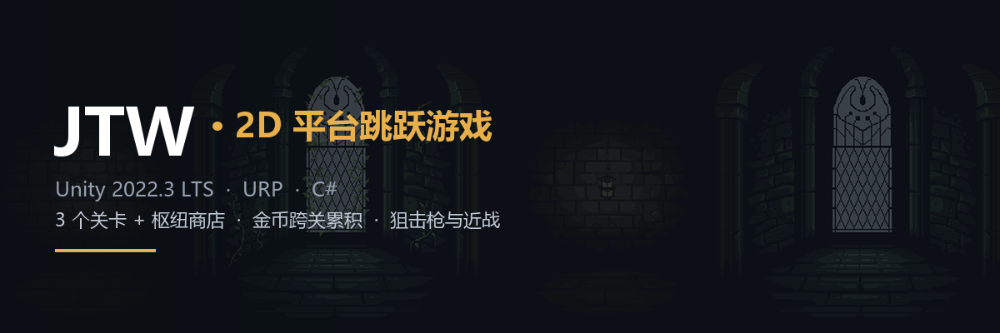
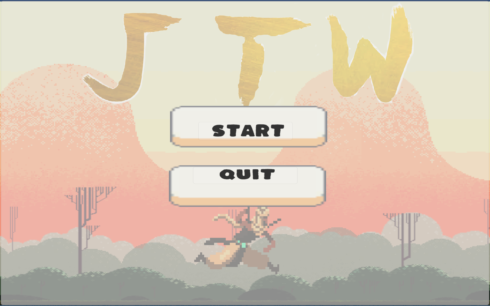
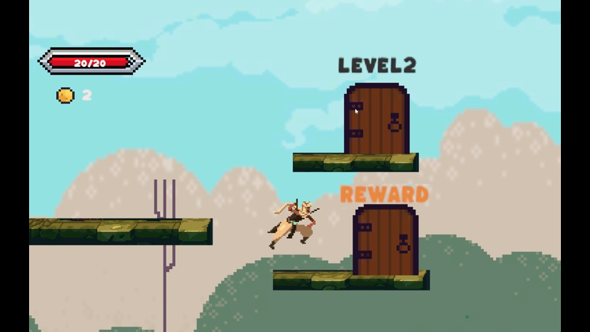
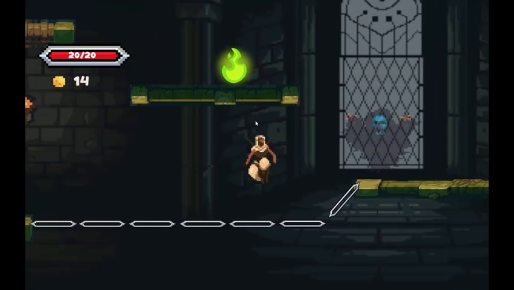
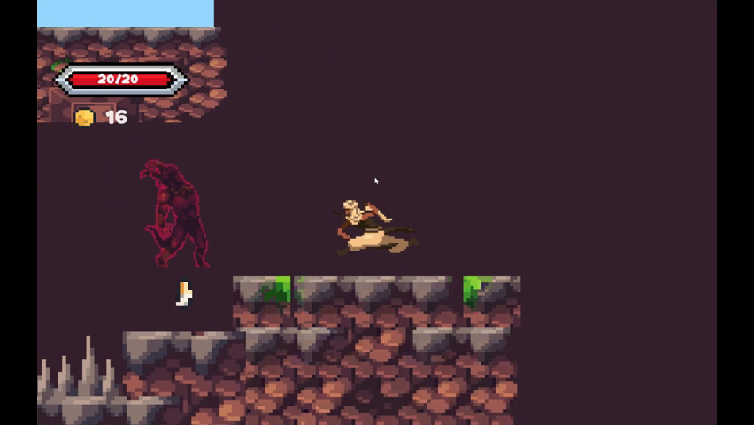
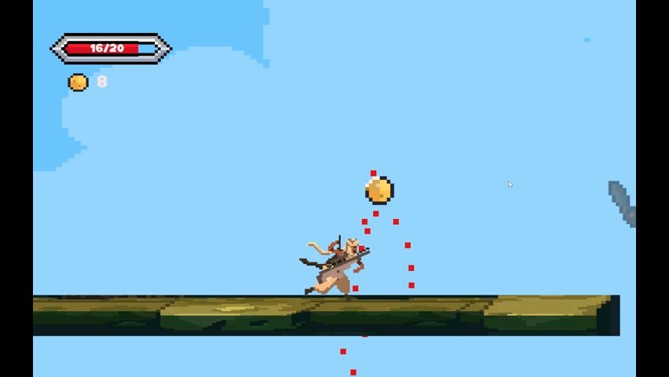
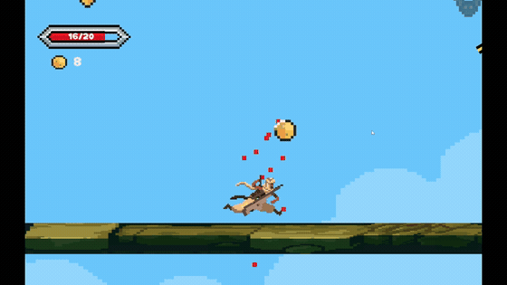
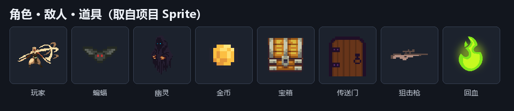
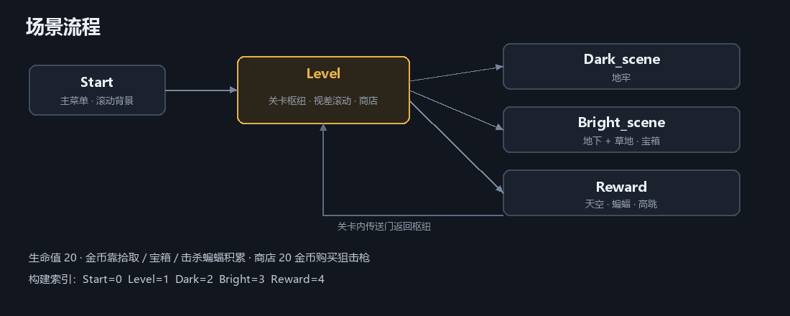

# JTW · 2D 平台跳跃游戏



一个用 Unity 制作的 2D 横版平台跳跃小游戏：**3 个风格各异的关卡 + 关卡选择枢纽 + 金币商店**。玩家在关卡中跳跃、战斗、收集金币，金币跨关卡累积，可用来购买狙击枪。

> 课程作业项目（JTW / hw3）。完整的设计思路与踩坑记录见 [设计报告](<素材及最终/JTW 2D平台跳跃游戏作业报告.md>)。

| 项目信息 | 值 |
| --- | --- |
| 引擎版本 | Unity **2022.3.17f1c1** |
| 渲染管线 | URP 14.0.9（未启用 2D Lighting） |
| 目标平台 | Windows（1920×1080） |
| 产品名 / 版本 | hw3 / 1.0 |
| 语言 | C# |

---

## 玩法概览

- **生命值**：每次进入关卡恢复为 **20**，受伤后不会自动回复；血量归零即游戏结束。
- **金币**：首次开始游戏获得 **10** 枚，通过拾取金币、开启宝箱、击杀蝙蝠积累；金币**跨关卡保留**（`PlayerPrefs`）。
- **商店**：在关卡选择界面花 **20** 金币购买**狙击枪**，购买后可在任意关卡使用。
- **关卡自由顺序**：三个关卡可通过枢纽界面的传送门自由选择，可反复游玩刷金币。

## 预览

> 以下画面全部截取自本项目的实机演示视频，非效果图。

### 实机画面



|  |  |
| :---: | :---: |
| **Level**：关卡选择枢纽，三个传送门与商店入口 | **Dark_scene**：城堡内部，幽灵与火焰道具 |
|  |  |
| **Bright_scene**：地下与草地，兽形敌人与地刺 | **Reward**：天空关卡，蝙蝠与金币 |

### 实机演示

击杀蝙蝠、掉血、拾取金币的连续画面：



完整演示视频（98 秒，28.9 MB）：[hw3-demo.mp4](docs/demo/hw3-demo.mp4)

### 素材图鉴



## 场景与流程



| 场景 | 构建索引 | 作用 |
| --- | --- | --- |
| `Start.unity` | 0 | 主菜单（含滚动背景） |
| `Level.unity` | 1 | 关卡选择枢纽：视差滚动背景、商店、3 个传送门 |
| `Dark_scene.unity` | 2 | 地牢关卡，光线阴暗 |
| `Bright_scene.unity` | 3 | 一半地下、一半草地，藏有宝箱 |
| `Reward.unity` | 4 | 天空背景的奖励关，蝙蝠成群、跳跃更高 |

流程：`Start` → `Level` ⇄ `Dark_scene` / `Bright_scene` / `Reward`（关卡内传送门返回 `Level`）。

> 构建配置里 `Menu.unity` 条目处于禁用状态且文件未入库，因此实际构建索引从 `Start` 开始计为 0。

## 操作

| 操作 | 按键 |
| --- | --- |
| 左右移动 | `A` / `D` 或 `←` / `→` |
| 跳跃 | `Space` |
| 近战攻击 | `J` |
| 显示狙击枪 | `G`（需已购买） |
| 隐藏狙击枪 | `H` |
| 射击 | 鼠标左键 |
| 暂停 / 继续 | `Esc` |

狙击枪会跟随鼠标位置旋转瞄准，每次点击左键发射一发子弹（子弹有射程限制）。

## 系统设计

### 生命与伤害

| 伤害来源 | 数值 |
| --- | --- |
| 敌人接触 | 由各敌人的 `damage` 字段决定 |
| 地刺（`Spike`） | 4 |
| 触发型伤害（`Trigger`，如 Beast 火焰） | 4 |
| 掉落死亡线（`Die`） | 直接死亡 |

血量以 `Filled` 图形式血条 + 数字显示，例如 `14/20`。

### 经济系统

| 来源 | 收益 |
| --- | --- |
| 拾取金币 | +1 |
| 开启宝箱 | 掉落 3 枚金币 |
| 击杀蝙蝠 | 掉落 1 枚金币 |
| 购买狙击枪 | −20 |

金币通过 `PlayerPrefs` 的 `CoinCount` 键在场景之间同步，避免切换关卡后丢失。

### 敌人

所有敌人继承自 `Enemy` 基类，统一实现：受伤**红闪**（`SpriteRenderer` 变红后 `Invoke` 复位）与**血液粒子**，以及接触玩家造成伤害。

| 敌人 | 行为 |
| --- | --- |
| `EnemyBat` | 在矩形范围内随机巡逻，死亡掉落金币 |
| `EnemyGhost` | 在左右两点范围内随机巡逻 |
| `EnemyDemon` | 在矩形范围内随机巡逻 |
| `EnemyBeast` | 守护金币；玩家触发其下方金库时燃烧化为火柱并造成伤害 |

巡逻逻辑为：在边界变换之间随机取点 → `Vector2.MoveTowards` 移动 → 到达后停留 `waitTime` 秒 → 取下一个点。

### 道具

| 道具 | 效果 |
| --- | --- |
| `Coin` | 拾取 +1 金币并播放音效 |
| `Magic` | 回复生命（血条显示钳制在 20） |
| `Treasure` | 玩家靠近自动弹开，掉落 3 枚金币 |
| `Fan` | 踩上后获得更强的起跳速度（`y = 12`） |
| `Spikes` | 触碰扣血 |
| `Door` / `DoorTo1` / `DoorTo2` / `DoorToR` | 传送门，加载对应场景并保存金币 |
| `PickUp`（枪） | 触发商店购买界面 |

## 项目结构

```
Assets/
├── Scenes/                 5 个场景（见上表）
├── Scripts/
│   ├── Player/             玩家移动、血量、近战攻击
│   ├── Enemy/              Enemy 基类 + Bat / Ghost / Demon / Beast
│   ├── Item/               金币、宝箱、魔法、门、枪、子弹
│   └── UI/                 主菜单、暂停、死亡菜单、商店、血条、金币数
├── Prefab/                 玩家、敌人、道具、Canvas 等预制体
├── Animation/              动画与 Animator Controller
├── Resources/              音效（拾取、受击、攻击、跳跃、回血、射击）
└── Material/               材质
docs/images/                README 配图与动画
docs/demo/                  实机演示视频（98 秒）
素材及最终/                  设计报告与美术素材
hw3.sln / Assembly-CSharp.csproj   生成的解决方案与工程文件
hw3.unitypackage            Unity 导出包
```

## 快速开始

1. 安装 **Unity 2022.3.17f1c1**（若使用 Unity Hub，可在 `2022.3.17f1` 打开，通常可向上兼容）。
2. 用 Unity Hub 打开本仓库根目录（`Assets`、`Packages`、`ProjectSettings` 所在目录）。
3. 打开 `Assets/Scenes/Start.unity`，点击 **Play**。
4. 发布构建：`File → Build Settings`，确认场景顺序为
   `Start → Level → Dark_scene → Bright_scene → Reward`。

> 首次打开时 Unity 会自动导入资源并生成 `Library/`，耗时较长属正常现象。

## 实现要点

- **视差滚动**：`LevelCamera` 根据相机位移同步移动远/中景层（远景 1.0×、中景 0.5×）；`Hill0` 通过滚动材质 `mainTextureOffset` 实现无限背景。
- **相机跟随**：`CameraFollow` 用 `Mathf.Clamp` 把相机限制在关卡边界内，再用 `Vector3.Lerp` 平滑跟随。
- **近战判定**：攻击用 `PolygonCollider2D` 作为攻击框，通过协程控制"延迟出现 → 持续一段时间 → 关闭"，避免一次点击多次判定。
- **随机巡逻**：在边界点之间随机取点 + `MoveTowards`，实现无寻路的自然游走。
- **卡墙修复**：玩家/平台碰撞体采用**圆角矩形**（`BoxCollider2D` 导圆角），避免跳跃时被直角边缘卡住；实测比调整物理材质更有效。
- **狙击枪显隐**：枪作为子对象挂在 `hold` 父对象上，由父对象的脚本控制 `SetActive`，解决了直接对枪自身 `SetActive(false)` 后无法再显示的问题。

## 已知限制

- 曾尝试接入 **2D Lighting**，因 URP 下出现较多问题、且需大量调整材质而放弃，当前为无光照的 2D 画面。
- `Assets/Scenes/Menu.unity` 在构建配置中被禁用，且文件未入库。
- `Assets/Resourcrs/` 目录名为拼写遗留（与 `Resources/` 并存），仅含空文件夹。
- 无设置菜单（音量/分辨率）、无存档界面，金币存档依赖 `PlayerPrefs`。
- 仅在 Windows 平台测试，未验证其他平台。
- README 中的实机画面截取自 852×480 的演示视频，非高分辨率录制。

## 素材与参考

**美术资源**（来自 itch.io 免费素材包）：

- Sprite：`elementals_wind_hashhashin_FREE_v1.1`
- 敌人与场景：`Monster_Creatures_Fantasy (v1.3)`、`EVil Wizard 2`
- BGM / 音效：`16-Bit Starter Pack`、`The Devil Tower`

**参考教程**：

- [Unity 视差效果与无限地图](https://www.bilibili.com/video/BV1Jz4y1u7qC/)
- [Unity 2D 鼠标点击发射子弹](https://www.bilibili.com/video/BV17a4y177Fk/)
- [Unity 2D 人物跳跃卡墙问题](https://tieba.baidu.com/p/6017739613)
- [Unity 场景切换保留数据](https://blog.csdn.net/BrosyveryOK/article/details/125650392)

## 作者

[@KAdler217](https://github.com/KAdler217)

本项目为课程作业，未附带开源许可证；素材版权归各自原作者所有。
